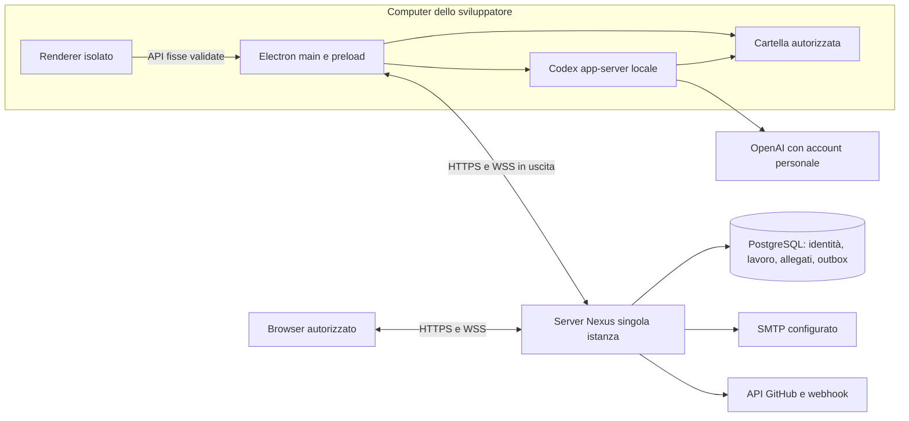

# Architettura

Nexus AI 0.17.0 è un monorepo TypeScript con desktop Electron, renderer React comune al web e server Fastify/PostgreSQL. Il desktop esegue Codex e opera sui file locali; il server gestisce identità Nexus e dati condivisi. Windows, macOS e Linux sono target reali con package nativi separati.



Il server può leggere i contenuti condivisi per applicare autorizzazioni e costruire proiezioni; non viene promessa cifratura end-to-end. File privati, home/keyring e credenziali Codex restano locali. La collaborazione non pubblica porte del computer e non conferisce controllo remoto del runtime. Il browser usa i domini condivisi e non esegue processi locali.

## Stack effettivo

| Area | Implementazione |
| --- | --- |
| Workspace | pnpm 10.32.1, TypeScript strict5.9.3; Node 22.19+ serie22 oppure24 |
| UI | React 19.3.1/Vite 8.3.4, token CSS, primitive accessibili, font locali |
| Desktop | Electron 44.9.0, preload ristretto e electron-builder 26.15.3 |
| Backend e identità | Fastify 5.12.7, Better Auth/plugin Electron 1.7.10, SMTP Nodemailer |
| Persistenza | PostgreSQL, Drizzle ORM0.45.4, migrazioni SQL additive e controllate |
| Realtime | WebSocket autenticato, outbox e ACK persistiti in PostgreSQL |
| Codex | Runtime ufficiale0.159.2 e schema generato della stessa versione |
| Codice/output | Componenti React per diff split/unified con linee e testo sicuro; output bounded senza HTML o terminale eseguibile |
| Grafici/effetti | SVG per indicatori e dati limitati; canvas per particelle/wave e scene decorative |
| Distribuzione | Container backend, strumenti DB, package nativi e workflow CI; nessun deploy remoto automatico |

Versioni complete e transitive sono nei manifest e nel lockfile. Il diff non incorpora Monaco né un IDE completo. Redis, broker e storage esterni non sono prerequisiti: gli allegati condivisi sono bounded e salvati in PostgreSQL.

```text
apps/
  desktop/                 # main/preload, runtime, Git, storage e package
  web/                     # renderer comune e domini UI
  server/                  # auth, API, realtime, webhook e readiness
packages/
  contracts/               # schemi/DTO e API pubbliche
  ui/                      # token, primitive ed effetti
  codex-bridge/            # supervisore app-server e schema generato
  db/                      # schema, migrazioni e strumenti operatore
deploy/                    # configurazione di hosting
docs/
examples/design/
.agents/skills/nexus-coordination/
```

## Identità e confini locali

Nexus e Codex hanno login separati. Better Auth gestisce account verificati, sessioni/revoca e inviti via SMTP. Il login desktop passa dal browser con PKCE e callback verificata; il main conserva il proprio segreto attraverso lo storage OS. Il renderer riceve solo DTO consentiti, senza cookie o API filesystem/processi generiche. [Account](auth.md), [collaborazione](collaboration.md).

Il main controlla mittente IPC, identità, ruolo tecnico e binding account/progetto prima delle operazioni locali. Cartelle canonicalizzate e argv separati evitano l'interpretazione shell di input remoto. `packages/contracts` non importa Electron/Node/DB; UI e renderer non importano runtime o persistenza server. Il controllo confini verifica gli import.

Codex usa un eseguibile fissato incluso nel package, una home dedicata per account e mapping locale dei thread. Nessuna importazione delle credenziali/config/chat di altre app. Login personale principale; API key soltanto esplicita e nessun fallback a consumo. Il supervisore applica timeout, framing/buffer limitati, annullamento e shutdown. ReadOnly è il default; workspaceWrite e approvazioni singole appartengono al driver locale. Un'approvazione cliente non diventa un permesso di esecuzione. [Protocollo e limiti](codex.md).

Contesto, bozza cifrata, Git e diff sono locali. Il server riceve solo estratti scelti dopo anteprima e audience; non riceve path della home, token o conversazioni private. DesktopGit usa operazioni argv fisse, controllo della snapshot e indice temporaneo per commit selettivi; niente hook/filtri o push impliciti. [Sessione](session.md), [repository](repositories.md).

## Dati condivisi e autorizzazioni

Il server applica membership e visibilità attuali prima di ogni lettura, mutazione, download e sottoscrizione. Client/viewer non ottengono informazioni tecniche interne soltanto perché un pulsante è nascosto. Lock ordinati workspace→project, versioni CAS e ricevute idempotenti proteggono le operazioni concorrenti e i retry.

| Dominio | Dati e comportamento |
| --- | --- |
| Collaborazione | Workspace/progetti, membri/inviti, repository condivisi; binding cartella separato sul dispositivo |
| Sessioni/realtime | Estratti autorizzati, testo selezionato live, offset/ACK/outbox e presenza con scadenza |
| Work | Task/milestone/commenti, documenti/update, revisioni deliverable, allegati, feedback e decisioni |
| Overview/Pulse | Proiezioni delle entità correnti, attività coalescenti, progressi da scope definito, notifiche e cursore letto |
| Repositories | Integrazione GitHub per account/repository, token cifrati AES-GCM, PR/review e webhook HMAC |
| Deployments | Ambienti con audience corrente, registrazioni manuali effettive, thumbnailPNG e health con fonte/TTL |
| Application | Ricerca autorizzata su10tipi pubblicati; nome e preferenze con versione |

Ogni mutazione pubblicabile salva risultato e invalidazione outbox nella stessa transazione. Le proiezioni usano dati correnti, senza trattare il payload storico come autorizzazione. La ricerca applica ACL prima di match, snippet e pagina; non indicizza file o cronologia privata Codex. Notifiche del progetto e badge usano il feed autorizzato e il cursore persistente; non sono notifiche email o push OS. [Contratti](contracts.md), [work](work.md), [application](application.md).

GitHub usa token dedicati con scope minimi e lease al solo main per la sincronizzazione esplicita. Le operazioni PR/review salvano ricevuta prima del POST e riconciliano esiti incerti; webhook raw firmati e deliveryID impediscono replay. Le prove automatiche con API controllata non dimostrano l'uso di un repository personale esterno.

## Realtime e recupero

Il WebSocket è autenticato mediante Origin/cookie prima dell'upgrade, senza token in query. La presenza è effimera: heartbeat15s e scadenza45s, distinta dal lavoro durevole. Il backend corrente è **singola istanza**; polling interno di outbox/permessi ogni2s, senza broker condiviso. Più repliche richiedono fanout e rate limit distribuiti prima dell'uso.

I batch di testo scelto hanno offset stabili e ACK dopo persistenza. La coda locale cifrata è bounded; può ritentare testo autorizzato, mai prompt, comandi o approvazioni eseguibili. Reconnect ricarica snapshot e permessi correnti; revoca o cambio audience invalidano anche le righe trattenute dal renderer. In assenza dell'autorità Nexus il turno locale viene interrotto, conservando cronologia e credenziale per il recupero. [Realtime](realtime.md).

T15 rafforza epoche dei comandi, attesa shutdown e frame stdin scaduti. Un errore React mostra un boundary focalizzato senza payload/stack e senza reload automatico. Un crash del processo renderer arresta Codex prima del dialogo esplicito Reload Nexus/Close window. La verifica usa soltanto renderer temporanei propri. [Recupero e revisione](design/t15-review.md).

## Osservazioni e preview

Gli indicatori derivano da fonti dichiarate: progressi task, risultati provider/test riconosciuti, record deployment e osservazioni health datate. Senza requisiti o con evidenze mancanti/scadute la health è unknown, senza score. Le registrazioni manuali non avviano pipeline o infrastruttura e il backend non effettua fetch degli URL del progetto. [Regola health](deployments.md).

CPU/memoria aggregate e HEAD loopback sono osservazioni locali opt-in, private e temporanee; nessun upload o polling implicito. La HEAD invia una sola richiesta senza cookie/body/redirect, con autorizzazione prima/dopo e scadenza30s.

Le preview deployment si aprono da ID riautorizzati in una BrowserWindow senza preload/Node, con sandbox e partizione effimera; popup/permessi negati e navigazioni limitate all'origine. Non ereditano il cookie Nexus. Nel browser il link usa noopener/noreferrer.

## Configurazione e distribuzione

Gli endpoint desktop vengono letti dal main prima di creare account/runtime/binding. Origini HTTPS o HTTP loopback, senza path/query/credenziali; modifica da disconnessi e riavvio esplicito. Ogni autorità custom usa un profilo userData distinto; il default mantiene il profilo già esistente. Il preload espone solo le origini validate e API fisse, la CSP limita le connessioni all'autorità attiva. Nome/preferenze sono sul server; movimento, cartelle e segreti locali mantengono la propria collocazione.

Il container ospita backend e renderer compilati, PostgreSQL privato e SMTP configurato; non esegue Codex. TLS/WSS e reverse proxy appartengono all'host. `/health` è distinto dalla readiness operativa `/ready`, che controlla database/schema/configurazione senza DDL o invio email. Le migrazioni e i restore sono azioni operatore esplicite; backup DB e segreti necessari al recupero vanno custoditi separatamente. [Self-host e upgrade](self-host.md).

| Piattaforma | Evidenza disponibile | Prova ancora distinta |
| --- | --- | --- |
| Windows | Build/package/smoke locali storici; risultati finali in status | Prova manuale finale0.16.0, firma se configurata |
| macOS | Check/test/build sul runner nativo CI T15 | Package/esecuzione desktop e Keychain/protocollo; firma/notarizzazione |
| Linux | Check/test/build sul runner nativo CI T15 | Package/esecuzione desktop e keyring/protocollo |

La [CI T15 riuscita sui tre OS](https://github.com/AndreaZero/nexus-ai/actions/runs/39099306162) verifica check/test/build, non l'accettazione grafica, il login personale o un package firmato. Il workflow di distribuzione e i risultati effettivi per versione sono descritti in [release](release.md) e [status](status.md). Le prove native del maintainer restano necessarie, incluso il Mac dal proprio dispositivo.

## Onboarding T17

La guida renderer riusa i contesti di account, collaborazione, binding e Codex senza nuovi privilegi o polling. I prerequisiti sono derivati dalle letture correnti; il progresso locale della guida conserva soltanto passo/rimando e una receipt della prima risposta, isolati per account e origine server, con progetto/repository/dispositivo/versione del binding. La receipt non autorizza operazioni. Il completamento osservato evita di forzare nuovamente il setup a ogni avvio freddo, mentre i check di disponibilità restano correnti. Client/viewer e browser si fermano al progetto condiviso.

Il repository può avere remoteUrl vuoto: remoto non configurato, senza URL fittizio o connessione GitHub. La colonna SQL esistente conserva questa assenza esplicita; gli URL presenti restano HTTPS validati. Le viste non interrogano GitHub finché manca un URL GitHub. Il setup Windows espone stato typed derivato dalla notifica ufficiale, distinto dall’accettazione della richiesta RPC; session.bindingUpdatedAt lega l’evidenza di risposta al binding aperto dal main. Nessuna nuova migrazione.
