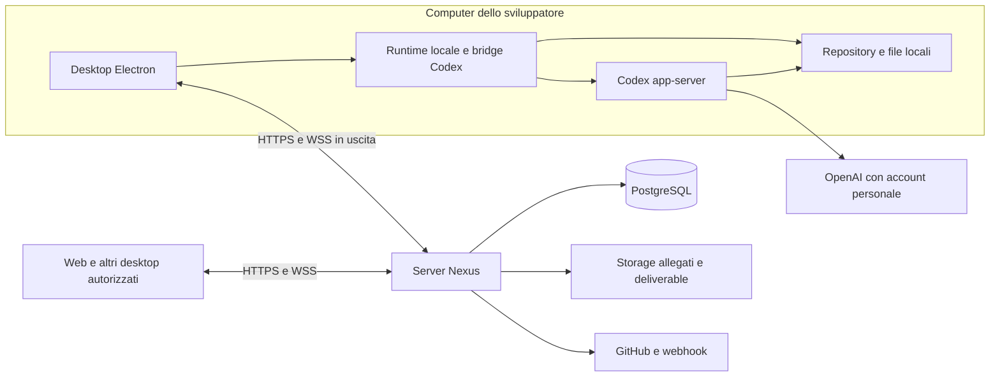

# Architettura

## Struttura del sistema

La base T01 è un monorepo TypeScript con backend Fastify e renderer React condiviso. Il desktop Electron aggiunge il confine locale isolato. Nei task successivi il server conserverà e distribuirà il lavoro condiviso e il browser servirà collaborazione e osservazione. Windows, macOS e Linux sono target desktop fin dalla prima configurazione.



Il server riceve contenuti selezionati per il progetto e applica la visibilità prima di inoltrarli. Non viene promessa cifratura end-to-end: il server deve poter elaborare i dati condivisi. Il filesystem del computer e le credenziali Codex restano locali. Nessuna porta del computer viene pubblicata per la collaborazione; l'eventuale callback di login è solo locale e temporanea.

## Stack proposto

| Area | Scelta | Motivazione |
| --- | --- | --- |
| Workspace | pnpm, TypeScript strict | Dipendenze e contratti condivisi, manutenzione da singolo sviluppatore |
| UI | React, Vite, CSS tokens, primitive accessibili | Fedeltà grafica senza un tema preconfezionato che imponga layout diversi |
| Desktop | Electron, preload ristretto, packaging nativo | Processi Codex/Git locali e UI comune sui tre OS |
| Backend | Node.js e Fastify | API e WebSocket nello stesso servizio modulare |
| Persistenza | PostgreSQL, Drizzle e migrazioni SQL; auth operativo da T03 | Pool server Node-only e migrazioni esplicite. Tenant/eventi nei task successivi |
| Identità Nexus | Better Auth 1.7.10, plugin Electron ufficiale | Account verificati, sessioni/revoca e SMTP; browser desktop con PKCE e storage OS cifrato, implementati in T03 |
| Realtime | WebSocket autenticato, outbox PostgreSQL | Eventi durevoli e presenza senza un broker obbligatorio |
| Codice e diff | Monaco caricato su richiesta; output terminale isolato | Confronto dei cambiamenti con linee, tab e output come reference 2 |
| Grafici ed effetti | SVG per dati piccoli; canvas per particelle ambientali | Controllo di wave, pianeta e glow senza un motore 3D pesante obbligatorio |
| Verifica | Typecheck/lint, test mirati, confronto visuale e build del maintainer | Confidenza proporzionata al cambiamento |

Nessun numero di versione è un vincolo prima di T01. T01 registra versioni effettive nel manifest/lockfile e una matrice compatibilità. Nessun servizio presente nei mockup, come Redis, email o database del gestionale illustrato, diventa automaticamente un requisito infrastrutturale di Nexus.

## Struttura prevista al termine dello sviluppo

```text
apps/
  desktop/                 # Electron main, preload, packaging e runtime locale
  web/                     # Renderer comune, rotte e feature di prodotto
  server/                  # API, auth, domini, realtime, webhook e job
packages/
  contracts/               # Schemi pubblici, DTO, eventi, comandi, capability
  ui/                      # Token applicativi, componenti, grafici ed effetti
  codex-bridge/            # Client app-server, schema generato, normalizzazione
  db/                      # Schema, query autorizzate e migrazioni
docs/
examples/design/
.agents/skills/nexus-coordination/
```

Queste directory esistono dalla base T01. Da T03 sono operativi identità Nexus, persistenza auth e accesso browser/desktop; T04 aggiunge il dominio collaborazione (workspace/progetti/membership/inviti/repository), client renderer in `apps/web/src/collaboration` e binding cartella account/dispositivo solo nel main. Le entità condivise sono in PostgreSQL e le mutazioni registrano un evento non segreto nella stessa transazione; broadcast/replay resta T08. Task/milestone/sessioni hanno solo tabelle vuote di base, nessun runtime o endpoint anticipato. `packages/ui` non importa DB/runtime; `packages/contracts` non importa Electron, Fastify o filesystem. `codex-bridge` e `db` restano Node-only; il controllo automatico verifica gli import renderer/UI/contratti.

T05 aggiunge runtime Codex nativo 0.159.2 incluso nel desktop, supervisore stdio typed e servizio main isolato per account Nexus. Home/keyring e mapping thread sono locali; nessun nuovo schema o endpoint backend. I turni operano in readOnly nella cartella canonicalizzata del binding T04, con ruolo tecnico riautorizzato e approvazioni di escalation declinate. Il renderer riceve DTO limitati di account/modelli/messaggi/attività attraverso IPC ristretto, senza RPC, path o credenziali generici. Condivisione delle sessioni e autonomia offline sono T08; il servizio T05 ricontrolla online i permessi correnti. Dettagli e prova personale in [codex.md](codex.md).

## Confini del desktop

T06 aggiunge `DesktopContext`: file scelti nativamente e bozza cifrata con controllo root/generation/account, preview esplicita, input file Codex e Git in sola osservazione. Il server conserva esclusivamente estratti revisionati tramite il dominio sessions e migrazione additiva 0002; nessun token o percorso provider/localhome. La condivisione è pull con permessi correnti; realtime resta T08. Fonte operativa: [session.md](session.md).

T07 aggiunge `DesktopWorkspace`: oggetti Git/file locali, UUID effimeri per apertura editor e preview esplicita nel browser di sistema. Nessun filtro/hook del repository o shell generica. `DesktopCodex` abilita workspaceWrite soltanto per scelta del driver locale e gestisce callback di approvazione singole con scadenza e controlli di contesto; nessun nuovo endpoint server, schema DB o controllo remoto. Diff/output/report sono proiezioni locali bounded, separati dagli estratti pubblicati.

T08 aggiunge `DesktopRealtime`, coda cifrata di solo testo scelto e `POST /api/realtime` + WebSocket autenticato. Outbox PostgreSQL nella stessa transazione di share/estratti, receipt idempotente dopo COMMIT e snapshot autorevoli al reconnect. Presenza effimera su una singola istanza backend, polling di eventi e permessi ogni 2 s, heartbeat15s/expiry45s; nessun Redis. Browser osservatore senza esecuzione e main desktop unico titolare di cookie/socket/coda. Durante indisponibilità dell'autorità Nexus, Codex conserva processo e cronologia ma interrompe il turno e non riesegue prompt/approvazioni. [Dettagli, limiti e prova](realtime.md).

T09 aggiunge una proiezione di lettura su outbox ed entità condivise correnti (`POST /api/overview`) e cursore notifiche persistente per utente/progetto, migrazione0004. Il feed coalescente non è una copia del protocollo Codex né un archivio completo dei delta. WS T08 invalida gli snapshot; i target autorizzati rimuovono subito le righe revocate anche mentre nuovi eventi attendono applicazione esplicita. `DesktopTelemetry` misura CPU/memoria aggregate solo dopo consenso locale, con binding/ruolo correnti e lease breve del consumatore; nessun upload o campione di rete inventato. [Overview e prova](overview.md).

- `main`: lifecycle runtime, selezione cartella, Git, processi locali e segreti Nexus protetti dal sistema operativo. Path mediante API native, processi con argomenti separati e senza composizione di comandi shell da input remoto.
- `preload`: metodi espliciti e validati, con verifica del mittente IPC. Nessun `exec`, `readFile` generico o accesso indiscriminato a `ipcRenderer` esposto alla pagina.
- `renderer`: stesso prodotto del web; sceglie le azioni da capability reali come `canRunLocalSession` e `canOpenLocalEditor`. Renderer isolato, sandbox, `nodeIntegration: false`, `contextIsolation: true` e CSP.
- Navigazioni esterne e deep link sono validati; preview esterne non ereditano il preload o i privilegi della finestra Nexus. Nessun `webview` privilegiato per una pagina deploy.
- Il processo Codex è supervisionato: avvio, stop, crash, ripresa, limiti buffer e shutdown senza processi orfani. Il percorso eseguibile e la sua versione sono verificati.

## Condivisione e consistenza

Ogni mutazione di dominio salva il risultato e un evento nella stessa transazione. L'outbox inoltra eventi autorizzati; i client applicano eventi per ID e cursore. Le proiezioni per overview e pulse derivano dagli stessi domini, evitando conteggi incompatibili tra schermate. La presenza scade tramite heartbeat e non è una misura durevole di lavoro.

Gli stream di testo vengono raccolti localmente, filtrati e trasmessi in batch brevi con offset stabili. Il server conferma solo batch persistiti. Una coda locale limitata può ritrasmettere eventi già autorizzati senza dupliche; non riproduce comandi, approvazioni o azioni eseguibili dopo una riconnessione. Gli eventi non ancora accettati devono essere visibili come non sincronizzati.

Ogni modifica a membership/visibilità invalida sottoscrizioni e cache. Il replay applica i permessi correnti, non quelli della data di creazione dell'evento. Il dettaglio del protocollo è in `contracts.md`.

## Piattaforme, distribuzione e hosting

| Piattaforma | Percorso previsto | Verifica |
| --- | --- | --- |
| Windows | Installer x64, runtime e percorsi Windows | Build e prova del maintainer su questa macchina |
| macOS | Artefatti arm64/x64 in base al Mac disponibile; identità bundle stabile | Build nativa dal Mac del maintainer più avanti; firma/notarizzazione quando configurate |
| Linux | AppImage x64 e istruzioni dipendenze desktop | Build su Linux/runner appropriato; prova manuale prima di dichiararlo verificato |

Usare directory dati OS, selettori cartella nativi, keychain disponibile e apertura editor con adapter per OS. Se lo storage sicuro non è disponibile, mostrare l'errore e richiedere una modalità esplicita: nessun salvataggio silenzioso in chiaro. Non dichiarare supporto verificato solo perché compila il TypeScript.

Il backend deve essere distribuibile come immagine/container con PostgreSQL, migrazioni controllate, storage allegati configurabile, email e URL pubblici HTTPS/WSS. Un singolo processo è sufficiente inizialmente; il broadcast deve dichiarare questo limite. Prima di più repliche introdurre fanout condiviso e rate limit coerenti, senza perdere l'outbox durevole. Non è autorizzato ora alcun acquisto o deploy a pagamento.

Backup/restore del DB, retention, log privi di contenuti sensibili e endpoint di health operativa fanno parte di T16. Le metriche dell'ambiente del progetto e quelle del server Nexus sono domini distinti.
